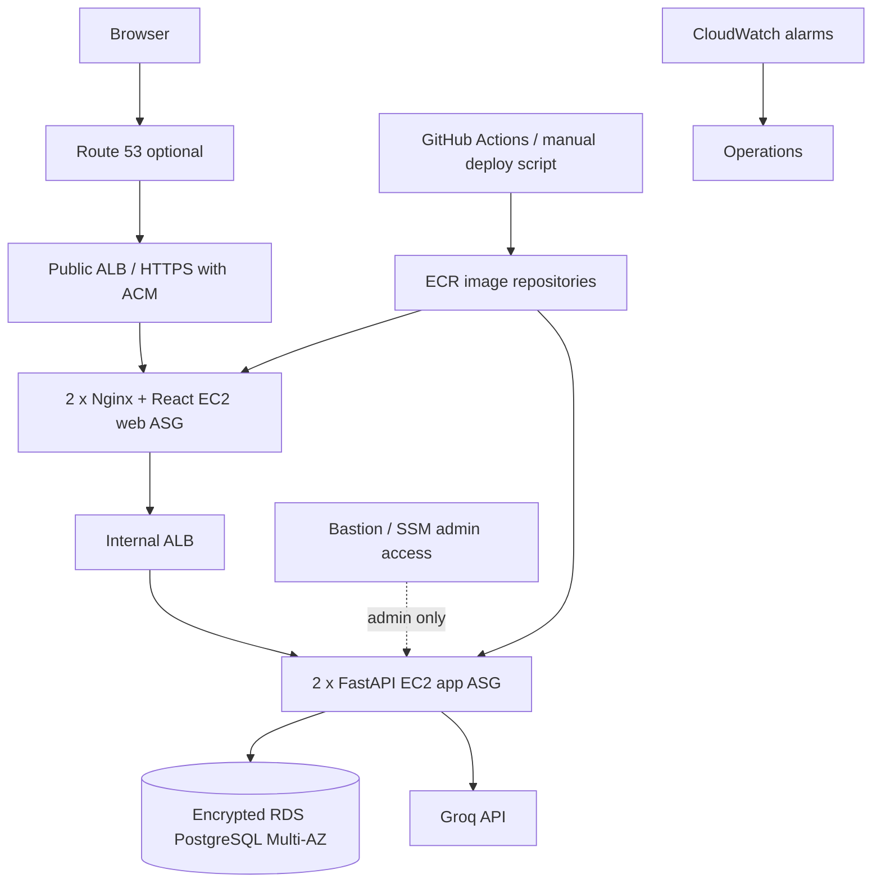

# Gen-AI-Labs

A ChatGPT-style AI workspace built with React + TypeScript, FastAPI, PostgreSQL and Groq inference. The primary AWS deployment path in this repository is Terraform-managed EC2 Auto Scaling behind public/internal Application Load Balancers. Kubernetes manifests are retained as an optional EKS learning path; they are not deployed by the EC2 Terraform stack.

## Features

- Email/password registration and JWT-protected API routes.
- User-owned conversations and PostgreSQL message persistence.
- Groq Chat Completions streaming over Server-Sent Events.
- Alembic database migrations.
- Docker Compose local environment.
- Terraform for a dedicated two-AZ AWS VPC, ALBs, EC2 Auto Scaling, SSM-only Bastion, ECR, RDS PostgreSQL Multi-AZ, Secrets Manager, least-privilege IAM, optional Route 53/ACM and CloudWatch alarms/logs.
- GitHub Actions CI for backend tests with coverage, frontend unit tests/build, Trivy source and container-image scans, and optional SonarQube analysis.

## Architecture



The Terraform stack creates a new VPC and does not modify existing VPCs in your account. It creates four application/web EC2 instances at desired capacity (two web + two app), plus one Bastion EC2 instance. Auto Scaling starts with two instances per tier and can scale to four per tier at 50% average CPU. This can raise costs; review the plan and budget before applying.

## Local run (Windows PowerShell)

Prerequisites: Docker Desktop with Compose v2, and a Groq API key from [Groq Console](https://console.groq.com/keys).

```powershell
Copy-Item .env.example .env
# Edit .env: set GROQ_API_KEY and a unique JWT_SECRET (32+ random bytes).
docker compose up --build -d
docker compose exec backend alembic upgrade head
```

Open:
- Web app: http://localhost:8081
- API docs: http://localhost:8000/docs
- Liveness: http://localhost:8000/health/live
- Readiness: http://localhost:8000/health/ready

Keep the local PostgreSQL volume: do not use `docker compose down -v` unless you intentionally want to delete local database data.

## Project layout

```text
backend/                 FastAPI, SQLAlchemy, Alembic and tests
frontend/                React + TypeScript + Vite + Nginx
database/                Database operations and local backup helper
infra/terraform/         AWS EC2/RDS/VPC infrastructure
infra/k8s/               Optional EKS Kubernetes manifests
infra/aws/               GitHub OIDC trust and deploy policy templates
scripts/                 Local and AWS deployment scripts
.github/workflows/       CI pipeline
```

Alembic migrations stay in `backend/alembic`; `database/` is for operational documentation and backup scripts, not a second migration source.

## Code quality, testing and security scanning

The GitHub Actions workflow `.github/workflows/ci-cd.yml` runs on pull requests and pushes to `main`. It performs:

1. Backend Python compilation and `pytest` tests with coverage.
2. Frontend Vitest unit tests and a TypeScript/Vite production build.
3. Trivy filesystem scanning for dependency vulnerabilities, infrastructure misconfigurations and exposed secrets.
4. Docker builds for backend and frontend, followed by Trivy image vulnerability scans.
5. SonarQube static analysis when its connection settings are configured.

### Configure SonarQube for GitHub Actions

Create a project in your SonarQube server (or SonarQube Cloud) with project key `gen-ai-labs`, generate a project analysis token, then configure these GitHub repository settings:

- Repository secret `SONAR_TOKEN`: the analysis token.
- Repository variable `SONAR_HOST_URL`: your reachable SonarQube server URL (for example, `https://sonar.example.com`).

The scan is intentionally skipped when these values are absent; the other CI and Trivy checks still run. A GitHub-hosted runner cannot reach a SonarQube server running only on your laptop. Use a reachable hosted server or a properly secured self-hosted runner. Do not expose an unauthenticated SonarQube server to the public internet.

### Run SonarQube locally (optional)

The local SonarQube service is behind the `quality` Compose profile and does not start during the normal app startup. It is for local evaluation only; use a properly configured external database and secured server for shared/production SonarQube.

```powershell
docker compose --profile quality up -d sonarqube
# Wait for http://localhost:9000 to become ready, then sign in and create a project/token.
$env:SONAR_TOKEN = '<project-analysis-token>'
docker run --rm -e SONAR_HOST_URL='http://host.docker.internal:9000' -e SONAR_TOKEN=$env:SONAR_TOKEN -v "${PWD}:/usr/src" sonarsource/sonar-scanner-cli
```

Default local SonarQube credentials should be changed immediately after first login. Stop the optional service when finished with `docker compose --profile quality stop sonarqube`.

### Run tests and scans locally (Windows PowerShell)

```powershell
Push-Location backend
python -m pip install -r requirements.txt
python -m compileall -q app tests
python -m pytest -q --cov=app --cov-report=xml:coverage.xml
Pop-Location

Push-Location frontend
npm ci
npm test
npm run build
Pop-Location

# Install Trivy separately, then run from the repository root:
trivy fs --scanners vuln,misconfig,secret --severity HIGH,CRITICAL --ignore-unfixed .
```

Trivy image scans are run by CI after both Docker images have been built. A HIGH/CRITICAL finding fails the security job; fix or formally assess the finding rather than disabling the scanner.

`.github/workflows/deploy-aws.yml` is a separate manual deployment workflow; it uses GitHub OIDC, pushes images to ECR, applies Alembic migrations once and rolls out EC2 containers sequentially through SSM. Configure the `production` GitHub Environment with secret `AWS_DEPLOY_ROLE_ARN` and variable `AWS_REGION=ap-south-1`. Create the AWS OIDC provider and role using `infra/aws/oidc-trust-policy.json` and `infra/aws/github-deploy-policy.json` after replacing `AWS_ACCOUNT_ID`. Restrict the role to this repository and protect the environment with required reviewers.

## AWS deployment (manual, operator-controlled)

Target region: `ap-south-1` (Mumbai), AZs `ap-south-1a` and `ap-south-1b`. The stack uses two NAT Gateways, two ALBs, four EC2 application/web instances, one Bastion, and Multi-AZ RDS. These are paid resources and can be expensive even when idle.

### Prerequisites

- AWS CLI v2 authenticated to the intended account; verify with `aws sts get-caller-identity`.
- Terraform >= 1.6, Docker Desktop, Git, PowerShell 7 recommended.
- AWS Systems Manager Session Manager access for the Bastion; the Terraform security group does not open inbound SSH.
- For HTTPS and custom DNS: an ACM certificate validated in `ap-south-1` and an existing Route 53 hosted zone. Without a certificate the ALB is HTTP only.
- A Groq API key and a random JWT signing secret. Never commit these values.

### Provision infrastructure

```powershell
Set-Location infra/terraform
Copy-Item .\terraform.tfvars.example .\terraform.tfvars
# Edit terraform.tfvars only if you are using a custom domain and ACM certificate.
# For a custom domain, also set domain_name, hosted_zone_id and acm_certificate_arn.
$env:TF_VAR_jwt_secret = '<strong-random-32+-byte-secret>'
$env:TF_VAR_groq_api_key = '<Groq-key>'
# Optional: omit TF_VAR_db_password to let Terraform generate the RDS password.
terraform init
terraform fmt -recursive
terraform validate
# Create only ECR repositories first so images exist before EC2 boots.
terraform plan -target=aws_ecr_repository.backend -target=aws_ecr_repository.frontend -target=aws_ecr_lifecycle_policy.backend -target=aws_ecr_lifecycle_policy.frontend -out=ecr-bootstrap.tfplan
terraform show ecr-bootstrap.tfplan
terraform apply ecr-bootstrap.tfplan
Set-Location ../..
.\scripts\push-images-bootstrap.ps1 -Region ap-south-1
Set-Location infra/terraform
terraform plan -out=tfplan
terraform show tfplan
# Review every resource and cost before proceeding.
terraform apply tfplan
```

**State security:** Terraform state contains sensitive values. Before production/shared use, run `scripts/bootstrap-tfstate.ps1`, copy `infra/terraform/backend.tf.example` to `backend.tf`, replace the printed bucket name and run `terraform init -migrate-state`. Never commit state or plan files. Do not store secret values in `terraform.tfvars`.

### Build, publish and deploy application images

After the initial ECR bootstrap and image push, and after the full Terraform apply creates ASGs and SSM-managed instances, return to the repository root and run:

```powershell
Set-Location ../..
.\scripts\deploy-aws.ps1 -Region ap-south-1
```

The script builds both images, pushes a Git commit tag plus the `current` tag, runs the Alembic migration on one app instance using SSM, then updates app and web instances sequentially. Alternatively, after configuring GitHub OIDC, use the manual `Deploy to AWS` workflow. Check SSM command results and ALB target health before declaring success. Both paths require ECR/SSM permissions and running EC2 instances registered with Systems Manager.

### Verify

```powershell
aws elbv2 describe-target-health --target-group-arn <web-target-group-arn> --region ap-south-1
aws autoscaling describe-auto-scaling-groups --region ap-south-1
aws ssm describe-instance-information --region ap-south-1
```

Use the Terraform output `public_alb_url`. For HTTPS, confirm the ACM certificate is attached and HTTP redirects to HTTPS. Test registration, login, conversation persistence, streaming, cross-user access isolation, database backups and recovery.

## Database operations

- Production database: encrypted RDS PostgreSQL Multi-AZ with seven-day automated backup retention and deletion protection.
- Schema migration source: `backend/alembic`. Deployment applies migrations before restarting API containers.
- Local backup helper: `database/scripts/backup-local.ps1`. Store backups encrypted and outside Git.
- Test point-in-time restore and snapshot restore in a separate environment before production sign-off.

## Security and production readiness

This is a production-oriented deployment scaffold, **not a verified production service**. The supplied source still requires a security review and additional controls before public customer use: HttpOnly Secure SameSite session cookies and CSRF protection (the current frontend stores JWT in localStorage), rate limiting/WAF, account recovery and email verification, audit logging, dependency/image scanning, load tests, disaster-recovery drills, and restore/failover testing.

- Never commit `.env`, credentials, Terraform state, database dumps or real customer data.
- Rotate any API key that has been included in an archive or shared outside its secret manager.
- RDS has no public access; security groups permit PostgreSQL only from the app tier.
- EC2 uses IMDSv2 and encrypted EBS. Use Secrets Manager for application/database secrets.
- Restrict Bastion SSH to your `/32`; SSM Session Manager is preferred.
- Configure an AWS Budget alert. A budget is an alert, not a spending cap or automatic shutdown.

## Optional Kubernetes path

`infra/k8s/` contains starter Deployment, Service, Ingress, HPA, migration and Karpenter manifests for a separate EKS deployment. They are not part of the EC2 Terraform deployment and require an EKS cluster, AWS Load Balancer Controller, Metrics Server, Karpenter/managed node group, secrets integration and separate IAM/RBAC setup. Do not deploy the EC2 and EKS paths simultaneously unless you intentionally want two independent environments and understand the additional cost.
