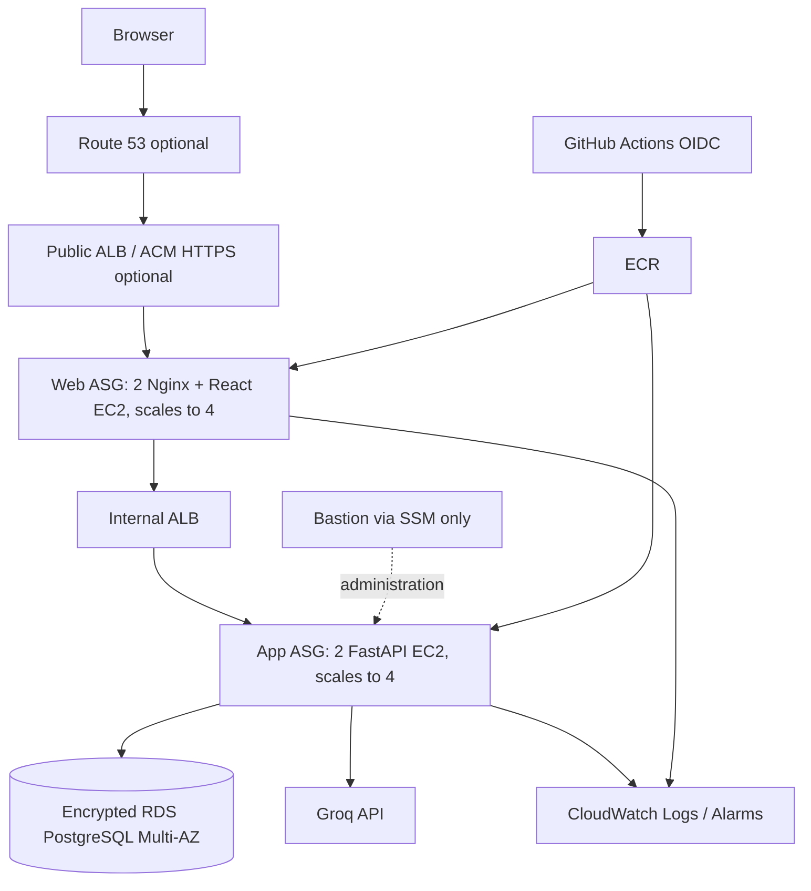

# Architecture and design

## Primary AWS deployment: EC2 Auto Scaling

The Terraform root creates a dedicated VPC in `ap-south-1`, two AZs, public/web/app/database subnets, two NAT Gateways, public and internal ALBs, ECR, web/app Auto Scaling Groups, an SSM-only Bastion, encrypted Multi-AZ RDS PostgreSQL, Secrets Manager, least-privilege EC2 roles, CloudWatch logs/alarms and optional Route 53/ACM integration. It does not change existing VPCs.

## Optional Kubernetes learning path

`infra/k8s/` retains Kubernetes Deployment, Service, Ingress, HPA, PDB, migration and Karpenter examples for a separate EKS environment. The primary Terraform stack does not create EKS or deploy these manifests. EKS is a separate, more expensive architecture and should not be provisioned alongside the EC2 stack unless a separate environment is intentionally required.

## Request lifecycle

1. Browser registers/logs in; API verifies bcrypt hash and returns a short-lived signed JWT.
2. Browser attaches bearer token to authenticated API requests.
3. Conversation endpoints filter by authenticated user ID.
4. Chat endpoint persists the user message, assembles recent conversation context and requests Groq streaming completion.
5. FastAPI emits SSE `data:` frames containing incremental text tokens. On successful completion it persists the assistant response.
6. Frontend incrementally renders deltas and refreshes the conversation list.

## Security and operational limitations

- RDS PostgreSQL is durable storage; local Compose uses a named PostgreSQL volume.
- Production secrets are retrieved from Secrets Manager by the app EC2 role. Terraform state still contains sensitive secret values; secure remote state before production use.
- Bastion has no inbound SSH rule; use Systems Manager Session Manager.
- The current browser stores JWT in localStorage. Add HttpOnly Secure SameSite cookies and CSRF protections before internet-wide exposure.
- Add rate limiting/WAF, account recovery, email verification, abuse controls, dependency/image scanning and audit controls before production customer traffic.
- Use backward-compatible database migrations; deployment applies Alembic migration once before sequential app/web rollout.
- Test RDS point-in-time restore, snapshot restore, failover, scaling, alarms and rollback in a staging account.
- The current model adapter is Groq-only. xAI requires a separate provider client, API base URL, model selection and provider-specific tests.
- Apply retention, export/deletion and privacy policies before storing real user conversations.
