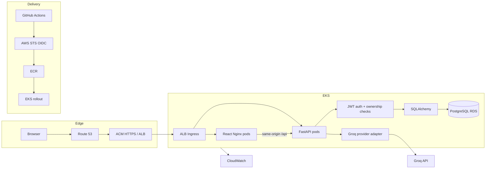

# Architecture and design

## Request lifecycle

1. Browser registers/logs in; API verifies bcrypt hash and returns a short-lived signed JWT.
2. Browser attaches bearer token to authenticated API requests.
3. Conversation endpoints always filter by authenticated user ID.
4. Chat endpoint persists the user message, assembles the recent conversation context and requests Groq streaming completion.
5. FastAPI emits SSE `data:` frames containing incremental text tokens. On successful completion it persists the assistant response.
6. Frontend incrementally renders deltas and refreshes the conversation list.

## Production decisions / limitations

- Use RDS PostgreSQL, not a database pod, for durable production data.
- Use Secrets Manager + External Secrets Operator; Kubernetes Secret objects are base64 encoded and are not a secrets vault.
- Add a session-cookie design, CSRF protection, rate limiting, account recovery and abuse controls before internet-wide exposure.
- The current model adapter is Groq-only. xAI requires its own client, API base URL, model selection and provider-specific tests.
- The first version stores full message text in PostgreSQL; apply retention, export/deletion and privacy policies before onboarding real users.
